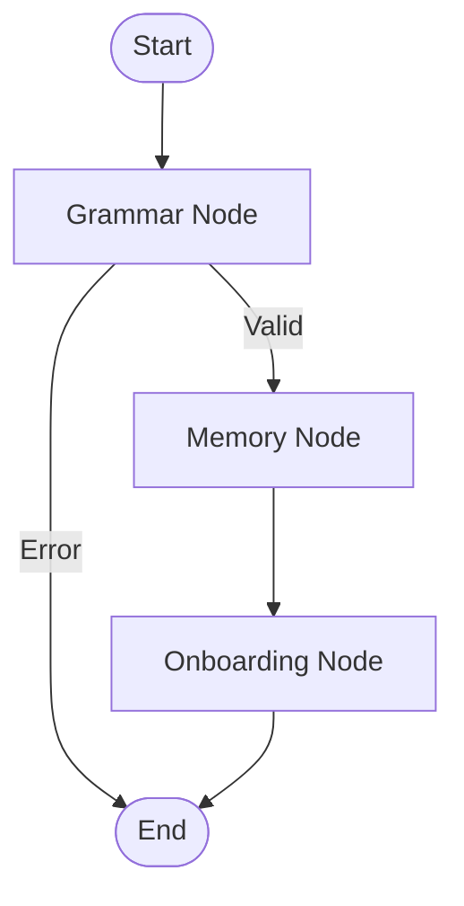
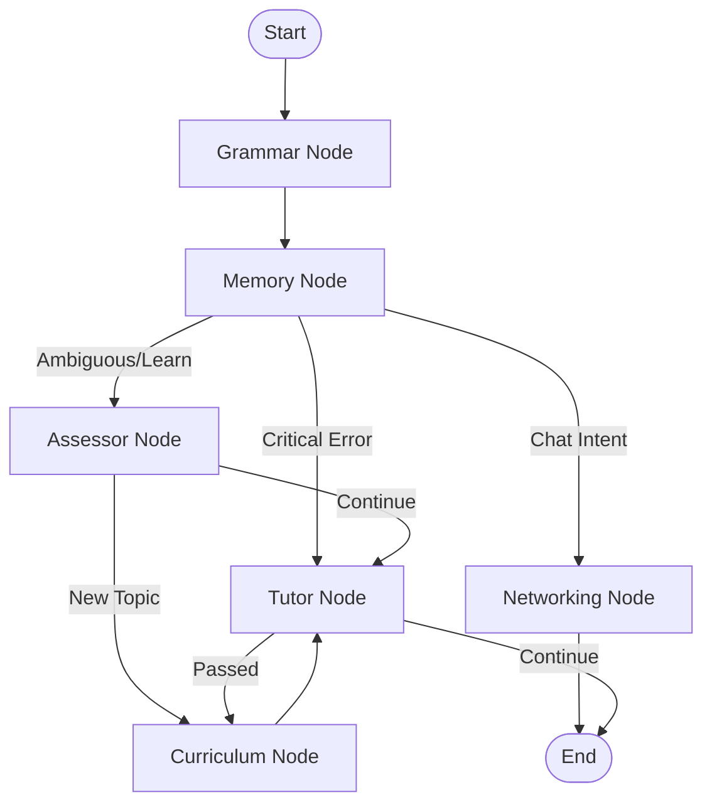

# Graph Module Documentation

This document provides a comprehensive overview of the graph-based architecture used in the application. The system utilizes `langgraph` to manage state and control the flow of conversation between different agents (nodes).

## Overview

The application is designed with a **Two-Graph Architecture**:

1.  **Onboarding Graph**: A dedicated flow for new users to collect essential profile information (name, interests, goals).
2.  **Main Graph**: The primary flow for returning users, handling networking (casual chat) and learning (structured lessons).

The system dynamically selects which graph to execute based on the `discovery_completed` flag in the user's state.

---

## State Management (`src/graph/state.py`)

The `AgentState` defines the shared data structure passed between nodes.

| Field | Type | Description |
| :--- | :--- | :--- |
| `messages` | `List[AnyMessage]` | History of conversation messages. |
| `user_level` | `str` | Current English proficiency level of the user. |
| `user_memory` | `List[str]` | General long-term memory items. |
| `current_topic` | `str` | The topic currently being taught or discussed. |
| `next_step` | `str` | Directive for the next action (e.g., "new_topic"). |
| `grammar_error` | `bool` | Flag indicating if the last user message had a grammar error. |
| `correction` | `str` | The corrected version of the user's message. |
| `is_lesson` | `bool` | Flag indicating if the current interaction is part of a formal lesson. |
| `audio_content` | `str` | Content for audio generation. |
| `progress` | `dict` | General progress tracking. |
| `current_mode` | `str` | Active mode: 'chat' or 'teach'. |
| `student_name` | `str` | User's name. |
| `student_interests` | `List[str]` | User's interests. |
| `student_goals` | `List[str]` | User's learning goals. |
| `discovery_completed` | `bool` | True if onboarding is finished. |
| `networking_memory` | `List[str]` | Specific memory for casual networking chats. |
| `learning_progress` | `dict` | Detailed tracking of lesson progress. |

---

## Onboarding Graph (`src/graph/onboarding_graph.py`)

**Purpose**: To guide the user through an initial interview process to gather their profile information.

### Nodes
-   **`grammar`**: Checks the user's input for grammatical correctness.
-   **`memory`**: Processes and stores relevant information from the conversation.
-   **`onboarding`**: The primary agent that asks questions to gather user details.

### Workflow
1.  **Entry**: `grammar` node.
2.  **Grammar Check**:
    -   If an error is found (`grammar_error=True`), the flow ends, returning the correction to the user.
    -   If correct, proceeds to `memory`.
3.  **Memory Processing**: Updates state with any new information.
4.  **Onboarding**: Generates the next question or response.
5.  **End**: Returns response to user.

### Diagram

---

## Main Graph (`src/graph/workflow.py`)

**Purpose**: Handles the core application logic for networking and learning.

### Nodes
-   **`grammar`**: Checks for grammar errors.
-   **`memory`**: Updates context and long-term memory.
-   **`networking`**: Handles casual conversation ("chat" mode).
-   **`assessor`**: Analyzes user intent to route between networking and learning.
-   **`curriculum`**: Determines the next topic or lesson plan.
-   **`tutor`**: Delivers educational content and feedback.

### Workflow
1.  **Entry**: `grammar` node.
2.  **Grammar Check**: Always proceeds to `memory`.
3.  **Memory & Routing (`route_after_memory`)**:
    -   **Critical Grammar Error** -> `tutor` (Immediate correction/explanation).
    -   **Chat Intent** -> `networking`.
    -   **Learning Intent/Ambiguous** -> `assessor`.
4.  **Assessor Routing (`route_learning_flow`)**:
    -   **New Topic Needed** -> `curriculum`.
    -   **Continue Lesson** -> `tutor`.
5.  **Tutor Routing (`route_after_tutor`)**:
    -   **Lesson Passed** (`[PASSED]`) -> `curriculum` (Advance to next topic).
    -   **Continue** -> End (Wait for user input).

### Diagram

---

## Node Descriptions

### `src/graph/nodes/assessor.py`
**Role**: The "Traffic Controller".
-   Analyzes the user's message and current context to decide if they should be in a casual chat (`networking`) or a structured lesson (`tutor`).
-   Determines if a topic change is requested or required.

### `src/graph/nodes/tutor.py`
**Role**: The "Teacher".
-   Delivers lesson content based on the `current_topic`.
-   Evaluates user responses to exercises.
-   Decides if a user has passed a concept (outputs `[PASSED]`).

### `src/graph/nodes/grammar_checker.py`
**Role**: The "Editor".
-   Reviews every user message for grammatical accuracy.
-   Populates `grammar_error` and `correction` in the state.
-   Does *not* generate conversational responses, only corrections.

### `src/graph/nodes/onboarding_node.py`
**Role**: The "Interviewer".
-   Runs a script of questions to extract `student_name`, `student_interests`, and `student_goals`.
-   Updates `discovery_completed` to `True` when finished.

### `src/graph/nodes/networking_node.py`
**Role**: The "Friend".
-   Engages in open-ended, casual conversation.
-   Uses `networking_memory` to recall personal details and hobbies.
-   Maintains a friendly, non-instructional tone.

### `src/graph/nodes/memory.py`
**Role**: The "Scribe".
-   Extracts relevant entities and facts from the conversation.
-   Updates `user_memory`, `networking_memory`, and `learning_progress`.
-   Ensures continuity across sessions.

### `src/graph/nodes/curriculum.py`
**Role**: The "Planner".
-   Selects the next appropriate topic from the configuration based on the user's level and progress.
-   Updates `current_topic` in the state.
